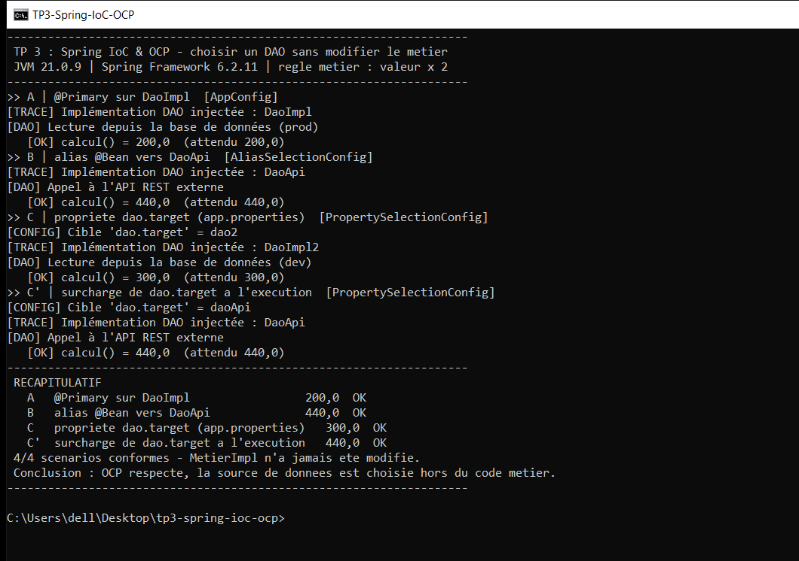

# TP 3 — Spring IoC & OCP

Sélectionner une implémentation de DAO **sans jamais modifier le code métier**.

> Lab du cours *Architecture Microservices : Conception, Déploiement et Orchestration* (MLIAEdu).
> Principe étudié : **OCP** (Open/Closed Principle) appliqué à la couche d'accès aux données.

## Résultat attendu (exécution réelle)



Les quatre scénarios sont exécutés dans des conteneurs Spring isolés, avec la même classe
`MetierImpl` (règle métier : `valeur × 2`) :

| Scénario | Sélection | Source lue | `calcul()` attendu | Obtenu |
|----------|-----------|------------|--------------------|--------|
| A | `@Primary` sur `DaoImpl` | base de données (prod) — 100.0 | 200.0 | 200.0 |
| B | alias `@Bean` vers `DaoApi` | API REST — 220.0 | 440.0 | 440.0 |
| C | propriété `dao.target=dao2` | base de données (dev) — 150.0 | 300.0 | 300.0 |
| C' | surcharge de `dao.target=daoApi` | API REST — 220.0 | 440.0 | 440.0 |

Sortie console correspondante :

```text
--------------------------------------------------------------------
 TP 3 : Spring IoC & OCP - choisir un DAO sans modifier le metier
 JVM 21.0.9 | Spring Framework 6.2.11 | regle metier : valeur x 2
--------------------------------------------------------------------
>> A | @Primary sur DaoImpl  [AppConfig]
[TRACE] Implémentation DAO injectée : DaoImpl
[DAO] Lecture depuis la base de données (prod)
   [OK] calcul() = 200,0  (attendu 200,0)
>> B | alias @Bean vers DaoApi  [AliasSelectionConfig]
[TRACE] Implémentation DAO injectée : DaoApi
[DAO] Appel à l'API REST externe
   [OK] calcul() = 440,0  (attendu 440,0)
>> C | propriete dao.target (app.properties)  [PropertySelectionConfig]
[CONFIG] Cible 'dao.target' = dao2
[TRACE] Implémentation DAO injectée : DaoImpl2
[DAO] Lecture depuis la base de données (dev)
   [OK] calcul() = 300,0  (attendu 300,0)
>> C' | surcharge de dao.target a l'execution  [PropertySelectionConfig]
[CONFIG] Cible 'dao.target' = daoApi
[TRACE] Implémentation DAO injectée : DaoApi
[DAO] Appel à l'API REST externe
   [OK] calcul() = 440,0  (attendu 440,0)
--------------------------------------------------------------------
 RECAPITULATIF
   A   @Primary sur DaoImpl                 200,0  OK
   B   alias @Bean vers DaoApi              440,0  OK
   C   propriete dao.target (app.properties)   300,0  OK
   C'  surcharge de dao.target a l'execution   440,0  OK
 4/4 scenarios conformes - MetierImpl n'a jamais ete modifie.
 Conclusion : OCP respecte, la source de donnees est choisie hors du code metier.
--------------------------------------------------------------------
```

## Structure du projet

```text
tp3-spring-ioc-ocp/
├── pom.xml
├── run-demo.cmd                 # lance la démo dans une console UTF-8
├── src/main/java/
│   ├── dao/
│   │   ├── IDao.java            # contrat commun
│   │   ├── DaoImpl.java         # BDD prod (100.0) — @Primary
│   │   ├── DaoImpl2.java        # BDD dev  (150.0)
│   │   ├── DaoFile.java         # fichier  (180.0)
│   │   └── DaoApi.java          # API REST (220.0)
│   ├── metier/
│   │   ├── IMetier.java
│   │   └── MetierImpl.java      # injection par constructeur, jamais modifiée
│   ├── config/
│   │   ├── AppConfig.java             # scan + @PropertySource
│   │   ├── AliasSelectionConfig.java  # stratégie B
│   │   ├── PropertySelectionConfig.java # stratégie C
│   │   └── SourceRegistry.java        # catalogue des sources
│   └── app/Main.java            # exécute et vérifie les 4 scénarios
├── src/main/resources/app.properties
└── src/test/java/app/SelectionStrategiesTest.java
```

## Les stratégies de sélection

| Stratégie | Où se décide la source | Pour changer de source |
|-----------|------------------------|------------------------|
| `@Primary` | annotation sur la classe DAO | modifier le code + recompiler |
| Alias `@Bean` | classe de configuration | modifier une ligne de configuration + recompiler |
| Propriété `dao.target` | fichier / variable d'environnement | redémarrer avec une autre valeur |
| Profil Spring | `@Profile` + profils actifs | changer le profil actif |

La stratégie C est privilégiée : la cible est entièrement externalisée.

```properties
# src/main/resources/app.properties
dao.target=dao2
```

Cibles acceptées : `dao`, `dao2`, `daoFile`, `daoApi`.
Surcharge possible sans toucher au fichier (résolution Spring `dao.target` → `DAO_TARGET`) :

```bat
set DAO_TARGET=daoApi
```

### Pourquoi `SourceRegistry` ?

Le bean qui expose l'`IDao` sélectionné est lui-même de type `IDao` : il ne peut donc pas
consommer la liste de tous les `IDao` du conteneur (auto-référence). Le catalogue
`SourceRegistry` sert de table de correspondance nom → implémentation, ce qui garde la
sélection lisible et évite toute dépendance circulaire.

### Pourquoi `MetierImpl` ne change jamais

```java
@Service
public class MetierImpl implements IMetier {
    private final IDao dao;

    public MetierImpl(IDao dao) {      // seule dépendance : l'interface
        this.dao = dao;
    }

    @Override
    public double calcul() {
        return dao.getValue() * 2.0;
    }
}
```

Changer de source de données ne demande aucune modification de cette classe : c'est
exactement ce que vérifie le scénario C' (même configuration, propriété surchargée,
`MetierImpl` identique, résultat différent).

## Construire, lancer, tester

Prérequis : JDK 21+ et Maven 3.6+.

```bat
mvn clean package
run-demo.cmd
```

Ou directement :

```bat
java -cp "target\classes;target\lib\*" app.Main
```

Tests de non-régression (JUnit 5) :

```bat
mvn test
```

```text
Tests run: 7, Failures: 0, Errors: 0, Skipped: 0
```

Les tests couvrent : `@Primary`, l'alias `@Bean`, les quatre cibles de `dao.target`
(test paramétré) et le rejet explicite d'une cible inconnue.

## Notes de conception

- Aucun `new DaoImpl()` dans la couche métier : les implémentations ne sont instanciées
  que dans la configuration ou le catalogue.
- Chaque scénario ouvre et ferme son propre conteneur (`try`-with-resources) : les
  stratégies sont comparées sans effet de bord entre elles.
- Les résultats sont vérifiés à l'exécution (`attendu` vs `obtenu`) : la démo échoue
  visiblement (`ECHEC`) si une configuration ne respecte plus le contrat.
